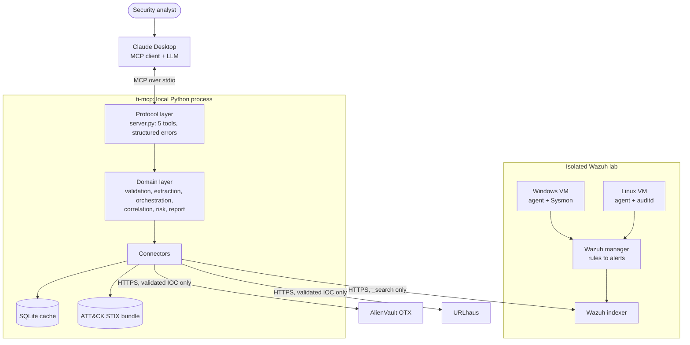

# Threat Intelligence MCP Server

A local MCP server that lets Claude qualify indicators of compromise (IOCs), typed in by hand or
extracted from real Wazuh alerts.

The server gathers evidence from AlienVault OTX, URLhaus and MITRE ATT&CK, then applies explicit risk
rules. No LLM runs inside it: every result is deterministic and traceable, and Claude only chooses the
tool and writes the final summary. The server is passive and read-only, and it never contacts an
indicator directly.

- [Project status](#project-status)
- [Architecture](#architecture)
- [MCP tools](#mcp-tools)
- [Risk model](#risk-model)
- [Security properties](#security-properties)
- [Getting started](#getting-started)
- [Configuration](#configuration)
- [Project structure](#project-structure)
- [Tests](#tests)
- [Roadmap](#roadmap)

## Project status

| Component | Status |
| --- | --- |
| MCP server and the 5 tools | Run over stdio |
| ATT&CK sync and lookups | Run against the real MITRE bundle |
| OTX connector | Mapping checked on live responses for benign indicators |
| URLhaus connector | Tested with mocks based on the API documentation, not yet with a real key |
| Wazuh connector and IOC extraction | Tested with mocks, not yet against a real Wazuh indexer |
| Wazuh lab | Setup guide only, not yet validated on real VMs |

## Architecture



### Layers

| Layer | Location | Responsibility |
| --- | --- | --- |
| Communication | MCP over stdio | Local process, no network port opened |
| Protocol | `ti_mcp/server.py` | Declares the tools and turns every failure into a structured error |
| Domain | `ti_mcp/domain/` | Business logic, independent of MCP and testable on its own |
| Connectors | `ti_mcp/connectors/` | One adapter per external system, with sanitized errors |
| Storage | `ti_mcp/storage/` | SQLite cache with a TTL |

### Alert analysis flow

What happens when Claude calls `analyze_alert`:

1. **Read:** fetch the alert from the Wazuh indexer with a read-only search.
2. **Extract:** collect candidate IOCs from known alert fields, then search the raw log text for URLs,
   IPv4 addresses and SHA-256 hashes.
3. **Validate:** type each candidate and discard internal or malformed values, recording the field and
   the reason.
4. **Enrich:** query every source in parallel, using the cache when possible, with a time limit per
   source.
5. **Correlate:** normalize tags, remove duplicates and detect disagreement between sources.
6. **Assess:** apply rules R1 to R4 to each IOC, with uncertainty reported separately.
7. **Report:** return JSON with the alert reference, the origin field of each IOC, sources and dates,
   resolved ATT&CK techniques, overall risk and limits.

## MCP tools

| Tool | Arguments | Purpose |
| --- | --- | --- |
| `analyze_indicator` | `value` | Full report for one IOC: sources, correlation, risk, uncertainty |
| `lookup_indicator` | `value`, `sources` (optional) | Per-source facts only, with no risk judgement |
| `get_attack_technique` | `technique_id` | ATT&CK technique from the local STIX data, such as `T1059.001` |
| `list_wazuh_alerts` | `limit` (1-100, default 20), `min_level` (0-16, default 3), `since_hours` (1-720, default 24) | Recent alerts, newest first, without raw logs |
| `analyze_alert` | `alert_id` | IOCs of one alert, enriched, with ATT&CK techniques and overall risk |

Supported IOC types: IPv4, IPv6, domain, HTTP(S) URL and SHA-256.

Source names for `lookup_indicator` are `alienvault_otx` and `urlhaus`.

### Example report

Shortened output of `analyze_indicator`:

```json
{
  "status": "partial",
  "indicator": { "type": "domain", "value": "threat.example" },
  "sources": [
    {
      "name": "alienvault_otx",
      "status": "ok",
      "source_reference": "pulse-123",
      "retrieved_at": "2026-11-02T22:15:10Z",
      "tags": ["botnet", "c2"],
      "is_malicious": true,
      "from_cache": false
    },
    {
      "name": "urlhaus",
      "status": "error",
      "retrieved_at": "2026-11-02T22:15:10Z",
      "error_code": "SOURCE_TIMEOUT"
    }
  ],
  "correlation": { "agreeing_sources": 1, "conflicts": [] },
  "risk": {
    "level": "medium",
    "rule": "R2",
    "explanation": "Exactly one source reports the indicator as malicious"
  },
  "uncertainty": { "level": "elevated", "reasons": ["1 source(s) unavailable"] },
  "limits": ["Passive threat-intelligence lookup only", "No direct contact with the indicator"]
}
```

### Errors

Tools return expected failures as data, in the form `{"error": {"code": "...", "message": "..."}}`.
Messages never include provider responses or exception text.

| Code | Meaning |
| --- | --- |
| `INVALID_INPUT` | Malformed value, or an internal value that may not leave the machine |
| `UNSUPPORTED_TYPE` | Recognized but unsupported indicator, such as a CVE |
| `SOURCE_TIMEOUT` | A source did not answer in time |
| `SOURCE_RATE_LIMITED` | A source is rate limiting requests |
| `SOURCE_UNAVAILABLE` | A source failed or is not configured |
| `ALERT_NOT_FOUND` | No Wazuh alert has this id |
| `TECHNIQUE_NOT_FOUND` | No ATT&CK technique has this id |
| `INTERNAL_ERROR` | Unexpected failure, with details only in the server logs |

## Risk model

Rules are checked in this order:

| Rule | Condition | Risk |
| --- | --- | --- |
| R1 | Two or more sources report the IOC as malicious | `high` |
| R2 | Exactly one source reports it as malicious | `medium` |
| R4 | No malicious report, but a source failed or gave no verdict | `indeterminate` |
| R3 | All sources answered and none reports it as malicious | `low` |

- **Uncertainty is separate from risk.** It becomes `elevated` when a source is unavailable, sources
  disagree or a rate limit was reached.
- **Alert risk** is the highest risk among its IOCs, ranked `high`, `medium`, `indeterminate`, `low`.
  An alert with no external IOC is `indeterminate`.
- **The Wazuh rule level is context only.** It never changes the risk.
- **A low risk is not proof of safety.** It only means these sources hold no malicious report.

## Security properties

- **Only validated public IOCs leave the machine.** Private, loopback and link-local addresses, plus
  names such as `.local`, `.internal` and `.lan`, are rejected before any external call. Agent and
  manager fields of an alert are never read for IOCs.
- **Raw logs do not reach the LLM.** Alert text can be attacker-controlled, so it is only searched for
  IOCs. Tools return validated IOCs and a fixed set of sanitized fields. Rule descriptions and IOC values
  can still carry attacker-influenced text, so they must be treated as data.
- **Wazuh access is read-only.** The server only calls `_search`. Use the dedicated read-only account
  described in the lab guide. TLS verification cannot be turned off.
- **Malware links are dropped.** URLhaus sample download links are never included in reports.
- **One failing source never blocks the others.** The report gets status `partial` and names the error.
- **Secrets stay local.** Keys come from the environment or a git-ignored `.env`, and are excluded from
  the settings `repr`. Logs go to stderr as JSON and do not include request URLs.

## Getting started

### 1. Install

Requires Python 3.12 or newer.

```powershell
py -3.12 -m venv .venv
.venv\Scripts\Activate.ps1
python -m pip install -e ".[dev]"
```

### 2. Configure

```powershell
Copy-Item .env.example .env
```

Fill in `.env`. An OTX key comes from [otx.alienvault.com](https://otx.alienvault.com) and a URLhaus
Auth-Key from [auth.abuse.ch](https://auth.abuse.ch). The server still starts without them: an
unconfigured source is reported as unavailable, so you can add each one later.

### 3. Download the ATT&CK data

```powershell
ti-mcp-sync-attack
```

This downloads about 50 MB from MITRE, and only replaces the existing file once the new one is proven
valid. Run it again to update.

### 4. Connect Claude Desktop

Add the server to `claude_desktop_config.json`, using the path of your checkout, then restart Claude
Desktop. An example is in
[docs/claude_desktop_config.example.json](docs/claude_desktop_config.example.json).

```json
{
  "mcpServers": {
    "threat-intel": {
      "command": "C:\\path\\to\\mcp-threat-intelligence-server\\.venv\\Scripts\\ti-mcp.exe"
    }
  }
}
```

With an editable install, the server finds the checkout's `.env` from any working directory.

### 5. Set up the Wazuh lab (optional)

Follow [docs/wazuh-lab.md](docs/wazuh-lab.md) to build the VMs and create the read-only account. Manual
IOC analysis works without it.

### Example requests in Claude

- *Analyze the domain threat.example.*
- *List the Wazuh alerts of the last 24 hours at level 7 or above, then analyze the most severe one.*
- *What is ATT&CK technique T1059.001?*

## Configuration

Settings are read from the process environment, then from `.env`. The process environment wins.

| Variable | Default | Purpose |
| --- | --- | --- |
| `OTX_API_KEY` | none | AlienVault OTX key |
| `OTX_BASE_URL` | `https://otx.alienvault.com/api/v1` | OTX endpoint, HTTPS only |
| `OTX_TIMEOUT_SECONDS` | `10` | OTX HTTP timeout |
| `URLHAUS_AUTH_KEY` | none | URLhaus Auth-Key |
| `URLHAUS_BASE_URL` | `https://urlhaus-api.abuse.ch/v1` | URLhaus endpoint, HTTPS only |
| `URLHAUS_TIMEOUT_SECONDS` | `10` | URLhaus HTTP timeout |
| `SOURCE_TIMEOUT_SECONDS` | `15` | Hard limit on one source lookup |
| `WAZUH_INDEXER_URL` | none | Indexer URL, such as `https://192.168.56.10:9200`, HTTPS only |
| `WAZUH_USERNAME` | none | Read-only indexer account |
| `WAZUH_PASSWORD` | none | Password of that account |
| `WAZUH_CA_BUNDLE` | system CAs | Path to the indexer's root CA |
| `WAZUH_ALERT_INDEX` | `wazuh-alerts-*` | Alert index pattern |
| `WAZUH_TIMEOUT_SECONDS` | `10` | Indexer HTTP timeout |
| `MAX_ALERT_INDICATORS` | `10` | Most IOCs looked up per alert; the excess is reported as `not_analyzed` |
| `TI_MCP_DATA_DIR` | `~/.ti-mcp` | Folder for the cache and ATT&CK bundle |
| `CACHE_DB_PATH` | `<data dir>/cache.sqlite3` | Cache database path |
| `CACHE_TTL_SECONDS` | `3600` | Cache lifetime; `0` disables the cache |
| `ATTACK_STIX_PATH` | `<data dir>/enterprise-attack.json` | ATT&CK bundle path |
| `TI_MCP_ENV_FILE` | none | Explicit path to the `.env` file |

Only successful answers are cached. A cached result keeps its original `retrieved_at` date and is marked
`from_cache: true`.

## Project structure

```
ti_mcp/
├── server.py             MCP tools and application wiring
├── config.py             Settings, .env loading, JSON logging
├── attack_sync.py        ti-mcp-sync-attack command
├── domain/
│   ├── models.py         Input and report models
│   ├── errors.py         Sanitized service errors
│   ├── validation.py     IOC typing and rejection of internal values
│   ├── extraction.py     IOC extraction from Wazuh alerts
│   ├── analysis.py       Parallel source lookups and per-IOC reports
│   ├── alerts.py         Alert listing and alert-level analysis
│   ├── correlation.py    Normalization, deduplication, conflict detection
│   └── risk.py           Rules R1 to R4 and uncertainty
├── connectors/
│   ├── base.py           Connector contracts and shared helpers
│   ├── otx.py            AlienVault OTX
│   ├── urlhaus.py        URLhaus
│   ├── attack.py         ATT&CK catalog from local STIX data
│   └── wazuh.py          Wazuh indexer, read-only
└── storage/
    └── cache.py          SQLite TTL cache and caching connector
tests/
├── unit/                 One module at a time
├── integration/          Full flows through an in-memory MCP session
├── security/             Rejection of internal and unsafe values
└── golden/               Reference indicator cases
docs/
├── wazuh-lab.md          Lab build guide
└── claude_desktop_config.example.json
```

### Adding a threat-intelligence source

1. Create a connector in `ti_mcp/connectors/` with a `name` and an async
   `lookup(indicator) -> SourceResult`, as defined by `ThreatIntelConnector` in `connectors/base.py`.
2. Return errors as a `SourceResult` with an `ErrorCode`, without provider details.
3. Add it to `build_connectors` in `ti_mcp/server.py`. Caching, time limits, correlation and risk rules
   then apply automatically.

## Tests

```powershell
python -m pytest
```

Tests use mock HTTP responses and do not contact external services, so they need no keys or lab.

## Roadmap

- Validate the connectors against a real Wazuh lab and a real URLhaus key
- MD5 and SHA-1 indicators
- Lab extension: web server and domain controller
- Grouping alerts into incidents
- Keyless sources: CISA KEV, EPSS, InternetDB, NVD
- Reputation sources: AbuseIPDB, VirusTotal, GreyNoise
- PostgreSQL storage, and an authenticated HTTP transport if needed
- SOC integration, with actions validated by a human
